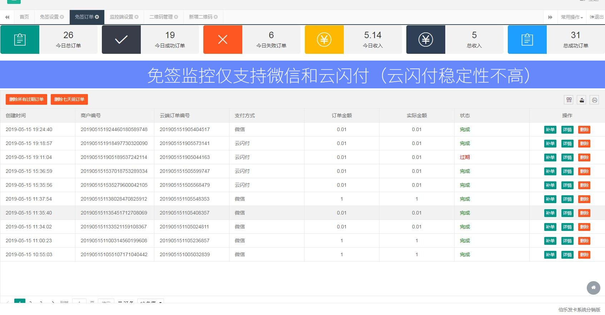
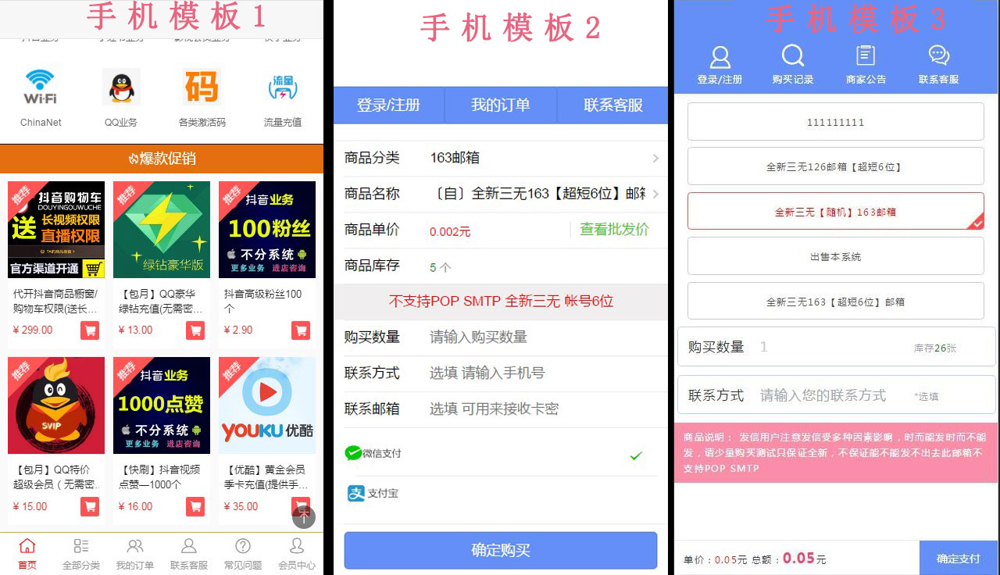
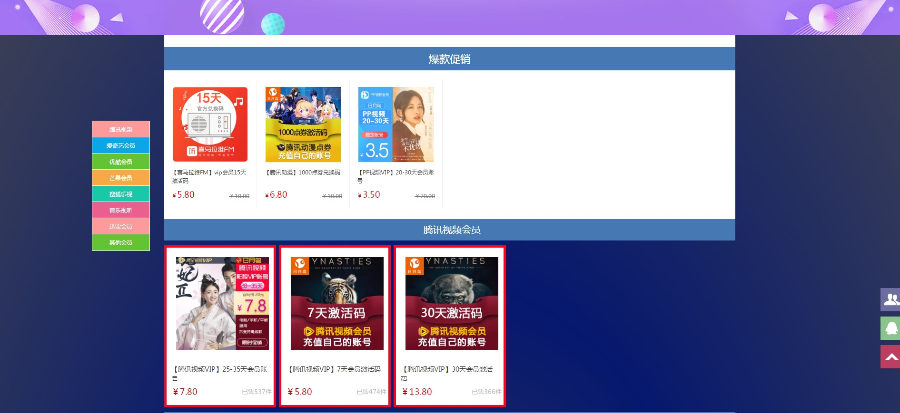
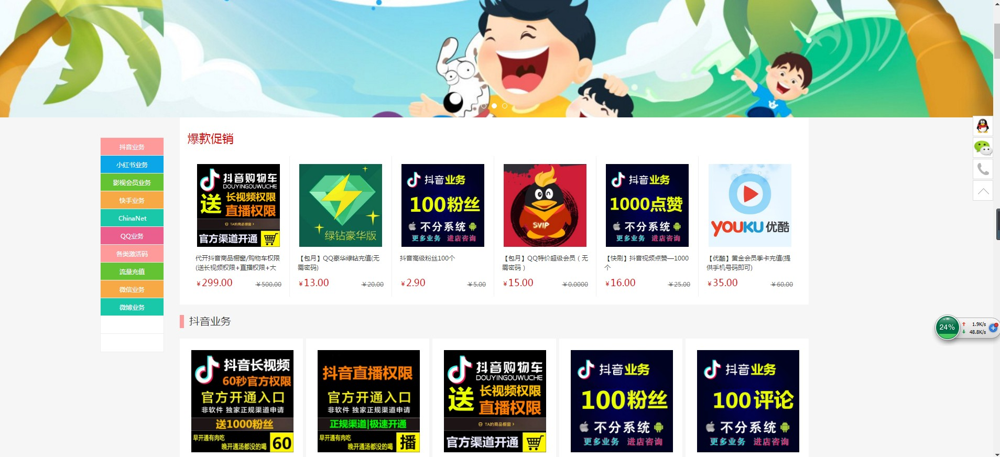
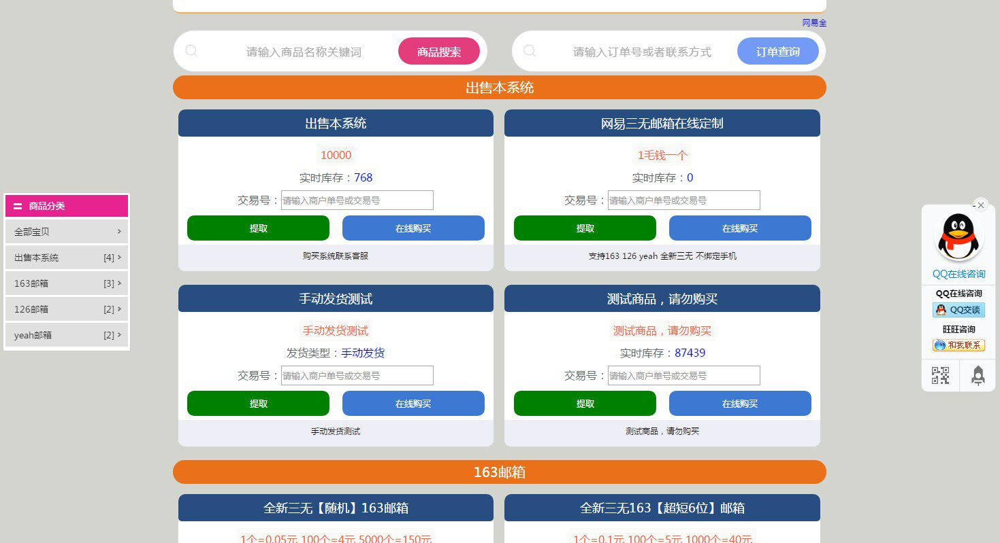
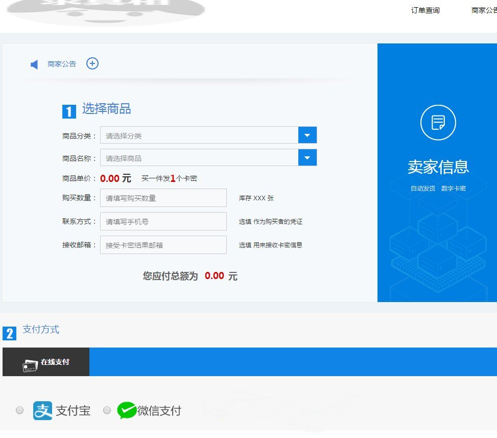
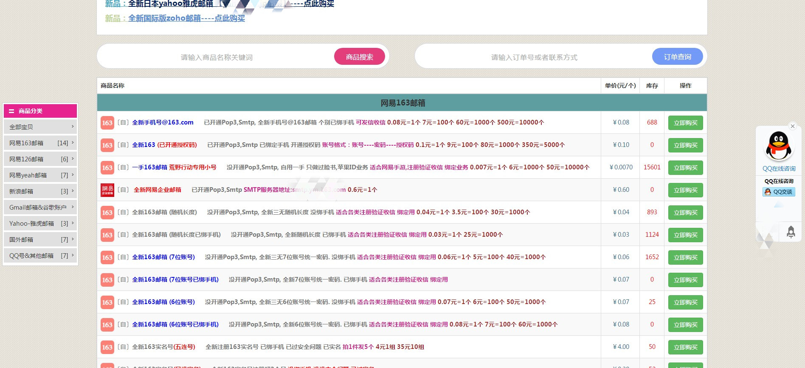

# 🎫 伯乐发卡高级版（ThinkPHP 5）

免授权伯乐发卡高级版源码：卡密商城 / 自动发卡，支持手机端 WAP、分站、分销、会员体系，以及多种免签与官方支付。

📦 **产品页**：[www.lailiyun.com/code/detail131.html](https://www.lailiyun.com/code/detail131.html)



---

## 🔗 仓库

| 平台 | 地址 |
|------|------|
| 🐙 GitHub | https://github.com/cloudwebsite/bole-faka-tp5 |
| 🪶 Gitee | https://gitee.com/lailiyun/bole-faka-tp5 |

---

## 🖼️ 界面预览

| 💻 PC 商城 | 🛠️ 后台 |
|:---:|:---:|
|  |  |

| 📱 手机端 | 💳 支付 |
|:---:|:---:|
|  |  |

| 📲 移动后台 | ✨ 更多 |
|:---:|:---:|
|  |  |

---

## ✨ 功能概览

- 🏪 **前台商城**：多套 PC / 手机模板，商品自动 / 手动发货，下单免责与首页公告
- 🔑 **卡密库存**：批量入库、渠道与批次、入库日志、按批删除未售库存
- 👥 **会员与分站**：会员组价格、余额 / 充值卡密、分站与分销加价
- 💰 **支付**：码支付、微信 JSAPI / H5、支付宝相关接口、USDT(TRC20) 等（以安装与后台配置为准）
- 🧭 **后台**：订单、商品卡密、销售 / 卡密统计、数据清理、移动端 madmin
- 🔄 **在线更新**：后台可从 GitHub / Gitee 双源检查并更新（配置已预置仓库信息）

---

## 🖥️ 运行环境

- PHP ≥ 7.4（建议 7.4 / 8.0+）
- MySQL / MariaDB
- 扩展：`curl`、`json`、`mbstring`、`openssl`、`pdo_mysql`；整包更新还需 `zip`
- Web 根目录指向 `public/`

---

## 🚀 安装

1. 上传代码，运行目录设为 `public`
2. 按安装向导完成（未安装时入口会引导）
3. 后台完善网站、支付、邮件等配置

---

## 🔄 在线更新（已配好双源）

进入后台 **在线更新**：选择 GitHub 或 Gitee → 检查更新 → 开始更新。

直接使用 `data/git_update.php`（仓库/分支已配好），无需复制。Token 只在后台弹窗填写，写回同一文件。

- 会跳过 `data/`、根目录 `conn.php`（数据库配置）、`public/favicon.ico`（网站图标）、`application/config.php`、`application/admin.php`、上传目录等本地数据
- Token：**后台「填写 Token」即可**，不必改配置文件
- 是否有更新：对比根目录 `version`（发版抬高该文件即可；`data/commit` 为本机增量基线，勿手改入库）
- **升级 SQL**：脚本放 `upgrade/sql/`（按文件名排序），更新结束后自动执行未跑过的；也可在后台点「执行升级 SQL」补跑

### 🔐 Token 获取示例（可选，用于 Star / 提高额度）

**🐙 GitHub**

1. 打开 https://github.com/settings/tokens  
2. 生成 Classic Token（或 Fine-grained）  
3. Classic 建议勾选 `public_repo`（公开库读写/Star 常用）；仅只读可不勾额外权限  
4. 后台「在线更新」→「填写 Token」→ 粘贴保存

**🪶 Gitee**

1. 打开 https://gitee.com/profile/personal_access_tokens  
2. 新建私人令牌，勾选与仓库、用户相关的权限（含 Star 所需项）  
3. 后台「在线更新」→「填写 Token」→ 粘贴保存

`data/git_update.php` 里 `auto_star` / `star_all_mirrors` 已为 `true`：检查或完成更新会尝试给双源点 Star；失败不影响升级本身。

---

## 📂 目录提示

```text
application/     业务模块（admin / jingdian / mobile / madmin / pay …）
public/          Web 入口与静态资源
extend/          扩展（含 GitOnlineUpdate）
assets/readme/   README 预览图
data/            安装与本地配置（Token、sql_applied 等，敏感项本地保留）
upgrade/sql/     在线更新自动执行的升级 SQL
runtime/         运行缓存（勿提交）
```

---

## 📝 近期更新摘要

后台「在线更新」会展示仓库根目录 `CHANGELOG.md`。完整列表也可看产品页。近期包括：Token 弹窗保存、卡密入库日志、销售/卡密统计、数据清理、移动后台、USDT 等。

---

## ⚠️ 声明

- 功能以演示与后台配置为准，不含演示站业务数据  
- 仅供学习研究；商用与合规由使用者自行负责  
- 侵权或授权请联系来利云：https://www.lailiyun.com/

---

## 📄 License

以仓库许可证及来利云产品页说明为准；未附许可证时请先取得授权。
